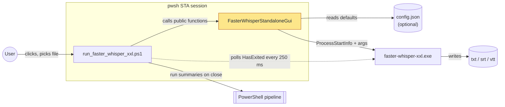
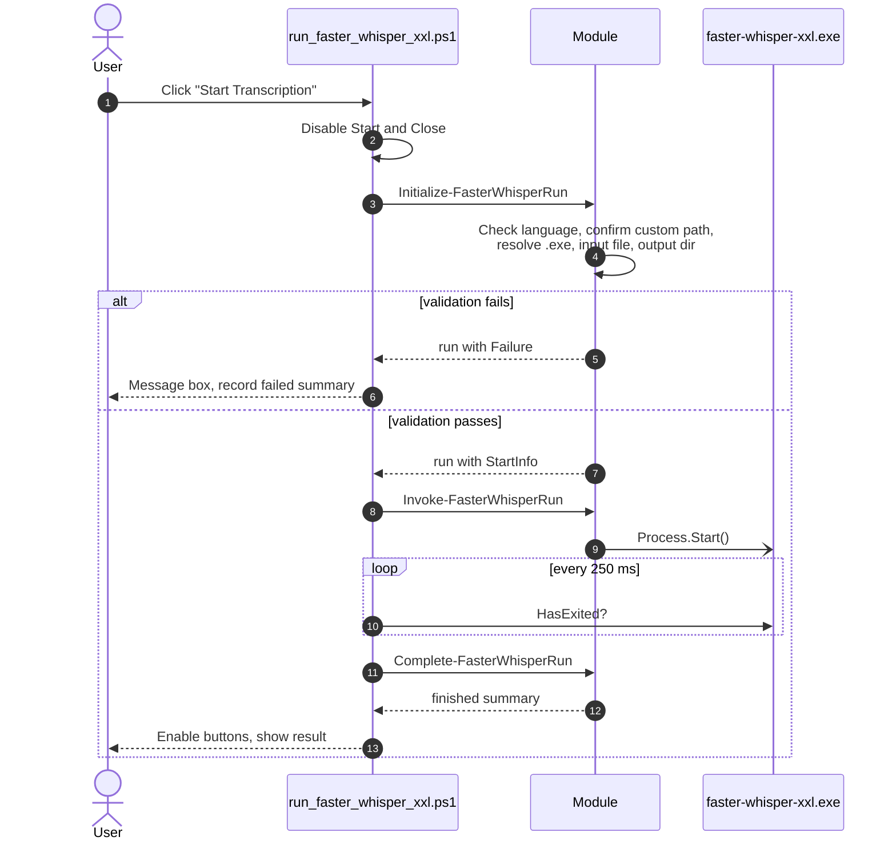

# Faster Whisper Standalone GUI (PowerShell)


> **Better alternatives:** [Buzz](https://github.com/chidiwilliams/buzz) (cross-platform), [Vibe](https://github.com/thewh1teagle/vibe) (cross-platform, whisper.cpp) and [MacWhisper](https://goodsnooze.gumroad.com/l/macwhisper) (macOS) are maintained, more capable, and easier to install than this Windows-only PowerShell wrapper. See [Alternatives & Successors](#alternatives--successors).

A Windows application that converts speech in audio and video files into text. It provides a simple graphical interface -- no command-line knowledge needed for basic use.

> _Claude was used to polish and proof-read the code and documentation of this repository._

<details>
<summary>Status and limitations</summary>

**Project status: archived independent project.** I developed this Windows PowerShell
transcription wrapper independently alongside my main professional work. It is no
longer actively maintained and remains available as a reference implementation or
starting point for adaptation, rather than a ready-to-use, supported transcription
product. Review the external executable and test compatibility with your setup before
reuse.

**Disclaimer.** Automated transcripts and translations can contain errors. Verify
important wording against the original recording; you are responsible for deciding
whether the output is suitable for your purpose.

</details>

**What it does:** Select an audio or video file (MP3, WAV, MP4), pick your settings, click "Start Transcription", and get a text transcript, subtitle file, or English translation.

All processing happens locally on your computer. No files are uploaded to the internet.

## Quick Start for Windows Users

**What you need:**
1. **Windows 10 or later**
2. **PowerShell 7+** -- Download from [Microsoft](https://learn.microsoft.com/en-us/powershell/scripting/install/installing-powershell-on-windows) if you do not have it
3. **faster-whisper-xxl.exe** -- Download from [Purfview/whisper-standalone-win](https://github.com/Purfview/whisper-standalone-win) and place it in the same folder as the script

**How to run:**
1. Right-click `run_faster_whisper_xxl.ps1` and select **Run with PowerShell 7** (or open PowerShell 7 and type `.\run_faster_whisper_xxl.ps1`)
2. Click **Browse** to select your audio or video file
3. Choose your settings (the defaults work well for most files)
4. Click **Start Transcription**
5. When finished, a message tells you where the output was saved

**Recommended first-time settings:**
- Model Size: `medium` (good balance of speed and accuracy)
- Device: `cpu` (works on any computer; use `cuda` if you have an NVIDIA GPU)
- Output Format: `txt` for plain text, `srt` for subtitles

## What this is (technical)

This project provides a WinForms-based GUI (`run_faster_whisper_xxl.ps1`) that launches an external transcription executable (default: `faster-whisper-xxl.exe`) with parameters selected in the GUI.
The GUI is intended for interactive use, while the pipeline output is intended for automation (CSV/JSON logging, filtering for failures, etc.).

## How it works

Three parts run on your machine: the WinForms script, the PowerShell module it imports, and the external engine `faster-whisper-xxl.exe`, started as a child process.



The script owns everything visible: the form, dialogs, the exit-poll timer and the list of run summaries. The module holds all logic that does not need WinForms (config parsing, validation, executable lookup, argument building, summary finalization), so it also loads on macOS and Linux. The engine is the only part that touches the audio; it writes its output files itself, and this repository never reads them. Nothing goes over the network.

Where in the code:

- [run_faster_whisper_xxl.ps1](run_faster_whisper_xxl.ps1): startup checks, form, `Start` click handler, `ExitPollTimer`, `FormClosing` handler, pipeline output
- [Get-FasterWhisperGuiConfig.ps1](Module/Public/Get-FasterWhisperGuiConfig.ps1): loads `run_faster_whisper_xxl.config.json`, falls back to [defaults](Module/Private/Get-FasterWhisperGuiDefaultConfig.ps1), clamps to the [option catalog](Module/Public/Get-FasterWhisperOptionCatalog.ps1)

### What happens when you click Start Transcription



Steps 3–4 never start anything: every check runs before the engine is launched, and a failed check still produces a summary (with an empty `ExitCode`), so a CSV log shows rejected runs too. Step 4 asks the user only when `ExecutablePath` contains a folder, and only once per session. The executable is looked up in the script folder first, then on `PATH`, and anything that is not a `.exe` is rejected. Step 10 polls from a UI-thread timer rather than a `Process.Exited` event, so the handler can touch the form and script variables directly.

If you close the window while the engine is running, the script asks: **Yes** kills the process tree, **No** lets it finish, **Cancel** returns to the form. In both of the first two cases the script waits for the process after the window closes, completes its summary, and then writes every summary of the session to the pipeline (see [Run summary output](#run-summary-output)).

Where in the code:

- [Initialize-FasterWhisperRun.ps1](Module/Public/Initialize-FasterWhisperRun.ps1): validation chain and `ProcessStartInfo` (steps 3–7)
- [Resolve-FasterWhisperExecutable.ps1](Module/Private/Resolve-FasterWhisperExecutable.ps1): script folder, then `PATH`
- [Get-FasterWhisperArgumentList.ps1](Module/Private/Get-FasterWhisperArgumentList.ps1): engine command line (`--model`, `--output_dir`, `--beep_off`, …)
- [Invoke-FasterWhisperRun.ps1](Module/Public/Invoke-FasterWhisperRun.ps1): starts the process (steps 8–9)
- [Complete-FasterWhisperRun.ps1](Module/Public/Complete-FasterWhisperRun.ps1) and [Close-FasterWhisperRunSummary.ps1](Module/Private/Close-FasterWhisperRunSummary.ps1): end time, duration, exit code, `Succeeded` (steps 11–12)
- [Close-FasterWhisperRunWithFailure.ps1](Module/Private/Close-FasterWhisperRunWithFailure.ps1): failed summary for steps 5–6

## Features

- WinForms GUI for selecting:
  - Audio/video file (MP3, WAV, MP4) and output directory
  - Processing device: `cpu` or `cuda` (NVIDIA GPU)
  - Language (2-letter code, `yue` or `haw`, or leave empty for auto-detection)
  - Model size: `base`, `medium` (default), `large-v2`, `large-v3`
  - Output format: `txt` (plain text), `srt` (subtitles), `vtt` (web subtitles)
  - Task: `transcribe` or `translate` (to English)
  - Advanced decoding parameters (`best_of`, `beam_size`, `patience`, `temperature`)
  - Completion notification sound (the engine's own beep)
  - Console progress display
- Automation-friendly output: one structured `PSCustomObject` per run
- JSON configuration for default GUI values (optional)

## Requirements

- Windows (WinForms GUI; not supported on macOS/Linux)
- PowerShell 7+ (`pwsh`)
- Faster Whisper standalone executable available (looked up in this order):
  - configured via JSON (`ExecutablePath`; a relative path is resolved against the script folder, and a path with a folder asks for confirmation once per session), or
  - in the same folder as the script, or
  - in `PATH`

  Files with any extension other than `.exe` (for example `.cmd` or `.bat` found via `PATHEXT`) are rejected.

## Quickstart (GUI)

See [Quick Start for Windows Users](#quick-start-for-windows-users) above for a step-by-step guide.

```powershell
.\run_faster_whisper_xxl.ps1
```

PowerShell 7 starts in STA mode by default. If the session is not STA (for example `pwsh -MTA`), the script stops with a message; start it with `pwsh -STA -File .\run_faster_whisper_xxl.ps1`.
Select an input file, configure options, click **Start Transcription**, and the result is saved to your chosen output folder. A structured run summary object is emitted to the pipeline for automation.

## Configuration (optional JSON)

Create `run_faster_whisper_xxl.config.json` next to `run_faster_whisper_xxl.ps1` (copy from `run_faster_whisper_xxl.config.json.example`).

Supported keys (all optional; invalid values fall back to defaults, `BestOf`/`BeamSize` are limited to 1-10, `Patience` to 0.1-2.0 and `Temperature` to 0.0-2.0):

- `ExecutablePath` (string)
- `Device` (`cpu` or `cuda`)
- `Language` (string)
- `Model`
- `OutputFormat` (`txt|srt|vtt`)
- `Task` (`transcribe|translate`)
- `BestOf` (number)
- `BeamSize` (number)
- `Patience` (number)
- `Temperature` (number)
- `PlayConfirmationSound` (boolean)
- `ShowCliProgress` (boolean)
- `UseInputDirectoryAsOutput` (boolean)

Example:

```json
{
  "ExecutablePath": "faster-whisper-xxl.exe",
  "Device": "cuda",
  "Language": "en",
  "Model": "medium",
  "OutputFormat": "txt",
  "Task": "transcribe",
  "BestOf": 3,
  "BeamSize": 5,
  "Patience": 1.2,
  "Temperature": 0.0,
  "PlayConfirmationSound": false,
  "ShowCliProgress": true,
  "UseInputDirectoryAsOutput": true
}
```

## Automation / logging

Even though the script is GUI-driven, it produces a structured object output that you can capture in an STA session.

```powershell
pwsh -NoProfile -STA -Command '$result = .\run_faster_whisper_xxl.ps1; $result | Format-List *'
```

Log runs to CSV:

```powershell
pwsh -NoProfile -STA -Command '.\run_faster_whisper_xxl.ps1 | Export-Csv -NoTypeInformation -Path .\transcription-runs.csv -Append'
```

## Run summary output

When the window closes, the script emits one object per attempted run (including runs rejected by validation) with these properties, always in this order:

- `InputFile`, `OutputDirectory`, `Device`, `Language`, `Model`, `OutputFormat`, `Task`
- `BestOf`, `BeamSize`, `Patience`, `Temperature`
- `PlaySound`, `ShowCliProgress`
- `Executable`, `StartTime`, `EndTime`, `DurationSeconds`, `ExitCode`, `Succeeded`, `ErrorMessage`

`ExitCode` is empty when the engine was never started. Fields that validation did not reach (for example `Executable` after an invalid language) stay empty. A valid `Language` is recorded in lowercase, and once the input file is found, `InputFile` and `OutputDirectory` are full paths. A run you stop by closing the window and choosing **Yes** has `ErrorMessage` `Transcription stopped by user.`

## Validation (build / run / lint)

Run from the repository root with PowerShell 7 (lint also runs on macOS/Linux; the GUI needs Windows). Linting requires PSScriptAnalyzer.

| Action | Command |
|--------|---------|
| **Lint** | `pwsh -NoProfile -Command 'Invoke-ScriptAnalyzer -Path . -Recurse -Settings ./PSScriptAnalyzerSettings.psd1 -EnableExit'` |
| **Run GUI** | `.\run_faster_whisper_xxl.ps1` |

There is no separate build step; the script and module are run directly. CI (`.github/workflows/ci.yml`) runs the same lint command on `windows-latest`.

## Repository layout

```
faster-whisper-standalone-GUI/
├── run_faster_whisper_xxl.ps1        Entry point: startup checks, WinForms window, run polling, pipeline output
├── run_faster_whisper_xxl.config.json.example
├── Module/                           FasterWhisperStandaloneGui module: all non-UI logic, loads on any OS
│   ├── FasterWhisperStandaloneGui.psd1   Manifest; FunctionsToExport is the only export list
│   ├── FasterWhisperStandaloneGui.psm1   Dot-sources Private/ then Public/
│   ├── Public/    Get-FasterWhisperOptionCatalog, Get-FasterWhisperGuiConfig,
│   │              Initialize-FasterWhisperRun, Invoke-FasterWhisperRun, Complete-FasterWhisperRun
│   └── Private/   config parsing, defaults, executable resolution, argument list,
│                  summary finalization
├── PSScriptAnalyzerSettings.psd1     Lint configuration (severity Error, Warning)
└── .github/       CI workflow and Dependabot
```

Dependency direction: the entry script depends on the module's public functions; the module never references WinForms. Put new validation, settings or process logic in the module (one function per file, private unless the script needs it) and keep the script limited to UI.

For archive notice and maintained alternative, see [ARCHIVE.md](ARCHIVE.md).

## Security

- Do not include secrets or personal data in issues, logs, or test fixtures.
- For reporting vulnerabilities, see `SECURITY.md`.

## Troubleshooting

- **”Transcription engine not found”**: Download `faster-whisper-xxl.exe` from [Purfview/whisper-standalone-win](https://github.com/Purfview/whisper-standalone-win) and place it in the same folder as the script. Alternatively, add its location to your system PATH or set `ExecutablePath` in the JSON config file.
- **No output files created**: Make sure the input file exists and the output folder is writable. Try selecting a different output directory.
- **CUDA errors or GPU problems**: Switch the Processing Device to `cpu` to verify the tool works, then check that your NVIDIA GPU drivers and CUDA toolkit are correctly installed.
- **No progress shown during transcription**: Check the “Show progress in console window” option before starting.
- **Script does not start**: Make sure you are using PowerShell 7+ (`pwsh`), not Windows PowerShell 5.1. You can check your version by running `$PSVersionTable.PSVersion` in PowerShell. If it stops with "This script needs an STA session", start it with `pwsh -STA -File .\run_faster_whisper_xxl.ps1`.

## Alternatives & Successors

> This project is archived. Consider these actively maintained alternatives:

| Project | Description | Link |
|---------|-------------|------|
| Buzz | Cross-platform Whisper GUI (Python) | [GitHub](https://github.com/chidiwilliams/buzz) |
| MacWhisper | Native macOS Whisper transcription app | [goodsnooze.gumroad.com](https://goodsnooze.gumroad.com/l/macwhisper) |
| Whisper.cpp | High-performance C++ Whisper port with GUIs | [GitHub](https://github.com/ggerganov/whisper.cpp) |
| Vibe | Cross-platform Whisper GUI built on whisper.cpp | [GitHub](https://github.com/thewh1teagle/vibe) |

## License

MIT. See `LICENSE`.
